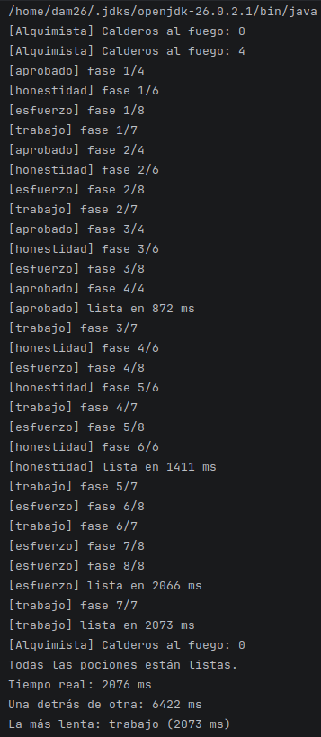
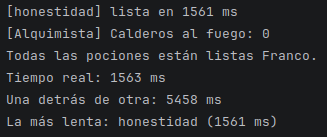
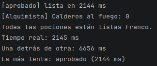
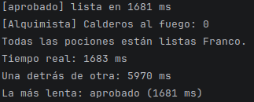

# Tarea 09b - El caldero de Don Magufo · tarea alternativa a la Tarea 09

Franco Naraza

## Salida en terminal:

## Tabla de pruebas

| Ejecución | Descarga más lenta | Tiempo real (ms) | Suma (ms) |
| --- |--------------------|------------------|-----------|
| 1 | `honestidad`      | 1563             | 5458     |
| 2 | `aprobado`    | 2144             | 6656     |
| 3 | `aprobado`      | 1681             | 5970     |

- ## E1:

- ## E2:

- ## E3:

## Declaración de uso de IA

**Herramienta usada:** Ninguna

>No usé IA como auto penalización por realizar la tarea pasada en un 100% con Claude.

